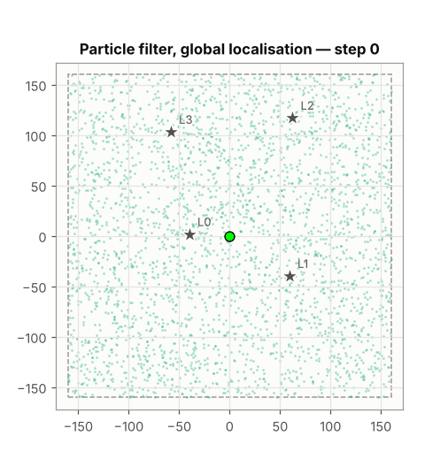
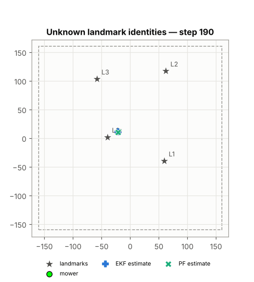

# Bayesian_Filters — where is the mower?

A robot lawnmower drives around a square lawn. We tell it where to go, but it never does exactly that, and
its sensors are noisy. This repository answers *where is it?* with every classical recursive
Bayesian filter: grid, Kalman, extended Kalman, unscented Kalman and particle filters. All of
them run on **the same simulated world and the same data**, so they can be compared honestly.

| Global localisation with particles | Kidnapped, landmarks not identified: EKF vs PF |
|---|---|
|  |  |

## The book

[`book/main.pdf`](book/main.pdf) is the theory behind the notebooks: one chapter per notebook,
with complete derivations and proofs, an *In words* box after each important result, and exercises
with full solutions. It covers the state-space model, the Bayes and grid filters, Gaussian
conditioning and the Kalman filter (information and Joseph forms, Riccati steady state, NEES), the
EKF (linearisation bias, the update as a Gauss–Newton step, data association), the UKF (accuracy of
the unscented transform, the update as statistical linear regression), and the particle filter
(importance sampling, ESS, resampling variance, augmented MCL, mode collapse as genetic drift).
The LaTeX sources are in `book/`; `make book` compiles it and `make figures` regenerates its
figures from the `bayesian_filters` package, with the notebooks' random seeds.

## The notebooks

Read them in order. Each one derives its filter, implements it, and tests it on the mower.

| # | Notebook | What you will see |
|---|---|---|
| 00 | [The mower's world](notebooks/00_the_mower_world.ipynb) | State, unicycle motion model with noisy controls, range–bearing / GPS / compass sensors, "banana" uncertainty, dead-reckoning drift |
| 01 | [The Bayes filter](notebooks/01_bayes_filter.ipynb) | Derivation of predict/update; an exact grid filter; a **bimodal** belief (range-only, two landmarks) that settles on the wrong bump before recovering; why grids do not scale |
| 02 | [Kalman filter](notebooks/02_kalman_filter.ipynb) | Derivation by Gaussian conditioning; a linear mower (compass + GPS); Riccati convergence of the gain; **NEES** consistency tests with a mis-tuned R |
| 03 | [Extended Kalman filter](notebooks/03_extended_kalman_filter.ipynb) | Jacobians (checked by finite differences), angle wrapping, ±2σ checks; where linearisation fails: NEES ≈ 300 after an uncertain start |
| 04 | [Unscented Kalman filter](notebooks/04_unscented_kalman_filter.ipynb) | Sigma points and scaled weights; the same arc, EKF vs UT; the UKF stays consistent where the EKF does not |
| 05 | [Particle filter](notebooks/05_particle_filter.ipynb) | Importance sampling, weight degeneracy and ESS, systematic vs multinomial resampling, global localisation, sample impoverishment, **multimodal beliefs with unknown data association**, mode collapse, kidnapping and augmented MCL |
| 06 | [Showdown](notebooks/06_showdown.ipynb) | All filters on four scenarios, several seeds each, and a scorecard |

### The short version of notebook 06

| Scenario | EKF | UKF | PF |
|---|---|---|---|
| Tracking, landmarks identified | RMSE 1.20, 0.09 ms/step | RMSE 1.20, 0.15 ms/step | RMSE 1.28, 0.66 ms/step |
| Uncertain start | converges, over-confident at first | converges, consistent | needs no guess, converges slower |
| Kidnapped, landmarks identified | recovers in ~64 steps (median) | same as EKF | recovers in ~15 steps (augmented MCL) |
| Kidnapped, landmarks **not** identified | lost in 6 of 8 runs | — | lost in 0 of 8 runs |

*Kidnapped* is the standard robotics name for a robot that is picked up and moved somewhere
else without being told (the *kidnapped robot problem*). The filter is then confidently wrong,
and must first notice it before it can find the mower again.

Use the EKF when the belief is roughly Gaussian, the UKF when the uncertainty is large compared
with the non-linearity, and the particle filter when the belief can be multimodal.

## Quick start

```bash
pip install -r requirements.txt
jupyter lab notebooks/          # the notebooks add the repo root to sys.path themselves
python -m pytest                # 18 tests: Jacobians, unscented transform, filter accuracy and consistency
make book                       # compiles book/main.pdf (needs a TeX Live install with latexmk)
```

Live demo, drawn with Python's `turtle` graphics module (needs Tk, e.g.
`sudo apt install python3-tk`):

```bash
python -m bayesian_filters.demo --filter pf --global-init --particles 3000
python -m bayesian_filters.demo --filter ekf
python -m bayesian_filters.demo --filter pf --association unknown --recovery --kidnap 300
python -m bayesian_filters.demo --help
```

Keys: `space` pauses, `q` quits.

## The package

```
bayesian_filters/
├── world.py     World (lawn, landmarks, true noise levels), motion & sensor models, simulate()
├── base.py      Filter interface (predict / update / mean / cov) and run_filter()
├── grid.py      GridFilter        histogram Bayes filter on position
├── kf.py        KalmanFilter      generic linear KF;  CompassGpsKF for the mower
├── ekf.py       EKF               known or nearest-neighbour data association
├── ukf.py       UKF               scaled sigma points, augmented control noise, circular means
├── pf.py        ParticleFilter    log-weights, ESS-triggered systematic resampling,
│                                  known/unknown association, augmented MCL, roughening
├── metrics.py   position RMSE, NEES and chi-square bounds
├── viz.py       matplotlib helpers (one fixed colour per filter)
└── demo.py      live demo (Python turtle graphics)
```

Every filter has the same interface, so comparing them takes three lines:

```python
from bayesian_filters import World, simulate, EKF, ParticleFilter, run_filter, position_rmse
import numpy as np

world = World.default()
run = simulate(world, n_steps=400, seed=1)
for f in [EKF.from_world(world, run.truth[0], np.diag([10, 10, 0.05])),
          ParticleFilter(world, 2000, init="global", seed=0)]:
    print(f.name, position_rmse(run_filter(f, run).means, run.truth, skip=20))
```

`scripts/make_media.py` regenerates the two animations above.

## Further reading

* S. Thrun, W. Burgard, D. Fox, *Probabilistic Robotics*, MIT Press, 2005. Chapters 2–4 and 7–8.
* S. Särkkä, L. Svensson, *Bayesian Filtering and Smoothing*, 2nd ed., Cambridge, 2023.
* S. J. Julier, J. K. Uhlmann, "A new extension of the Kalman filter to nonlinear systems", 1997.
* E. A. Wan, R. van der Merwe, "The unscented Kalman filter for nonlinear estimation", 2000.
* A. Doucet, A. M. Johansen, "A tutorial on particle filtering and smoothing: fifteen years later", 2009.
* Background: [advanced-calculus-for-ml](https://github.com/CL-BZH/advanced-calculus-for-ml), the calculus behind the Jacobians, Taylor expansions, Gauss–Newton steps and densities used here.
* Sequel: [Deep-Kalman-Filters](https://github.com/CL-BZH/Deep-Kalman-Filters), where the models are learned.
* Sequel: [vslam-course](https://github.com/CL-BZH/vslam-course), visual SLAM for the same robot mower: smoothing over a factor graph instead of filtering.

Reference pages (notation, models, pitfalls) are on the
[project wiki](https://github.com/CL-BZH/Bayesian_Filters/wiki).
